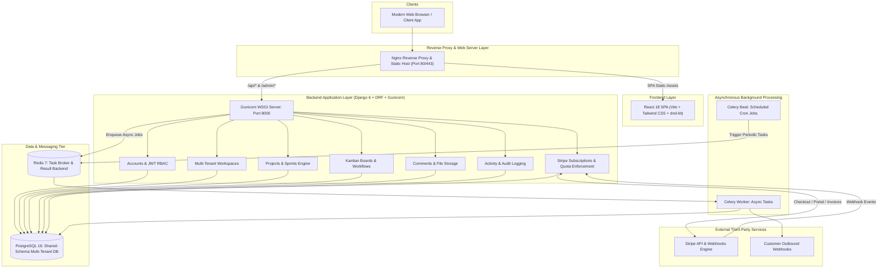

# SprintSync – Multi-Tenant SaaS Project Management Platform

[](https://github.com/sprintsync/sprintsync/actions/workflows/ci.yml)
[](https://www.djangoproject.com/)
[](https://react.dev/)
[](https://tailwindcss.com/)
[](https://www.postgresql.org/)
[](https://www.docker.com/)

---

## 1. Project Introduction & Overview

**SprintSync** is a production-grade, multi-tenant SaaS Project Management Platform inspired by modern engineering tools like Jira, Linear, and Asana. It provides end-to-end agile issue tracking, interactive drag-and-drop Kanban boards, sprint lifecycle management, team collaboration, task file attachments, automated background processing, custom Kanban workflows, audit logging, Stripe-powered multi-tier subscription billing, Dockerized container orchestration, and automated GitHub Actions CI/CD pipelines.

### Problem Statement
Software engineering and product teams require an integrated, secure, and isolated project management environment that can support multiple independent organizations (tenants) without data leakage. Existing open-source tools often lack built-in multi-tenancy, granular role-based access controls, tiered SaaS subscription enforcement, and background automation in a unified stack.

### Project Objectives
- **Shared-Schema Multi-Tenancy**: Enforce 100% strict tenant isolation across all database queries using workspace scoping (`workspace_id`).
- **Granular RBAC**: Implement role-based access control with predefined hierarchical roles (`OWNER`, `ADMIN`, `PROJECT_MANAGER`, `MEMBER`, `VIEWER`).
- **Agile Project Management**: Interactive `@dnd-kit` Kanban boards, backlog and sprint lifecycles, and customizable workflow transitions.
- **Collaboration Suite**: Task comments, file attachments with strict size validation, live activity timelines, and security audit logs.
- **Asynchronous Automation**: Celery and Redis task queue handling notifications, scheduled background jobs, and signed customer webhooks (HMAC-SHA256).
- **SaaS Billing & Limits**: Multi-tier subscriptions (`FREE`, `PRO`, `BUSINESS`) with automated Stripe Checkout, customer portals, webhook event processing, and quota enforcement.
- **Enterprise DevOps**: Multi-container Docker Compose orchestration, production Nginx reverse proxy, and GitHub Actions CI pipelines with full test suites.

---

## 2. System Architecture



---

## 3. Technology Stack

### Backend
- **Framework**: Django 6.0 + Django REST Framework (DRF)
- **Authentication**: `djangorestframework-simplejwt` (Token rotation & blacklisting)
- **Database Driver**: `psycopg` (v3 with binary bindings)
- **Asynchronous Processing**: Celery 5.4 + Redis 7
- **Billing & Subscriptions**: Stripe API (`stripe` Python SDK)
- **WSGI Production Server**: Gunicorn
- **Static Asset Serving**: WhiteNoise (`CompressedManifestStaticFilesStorage`)

### Frontend
- **Framework**: React 18 + Vite 6
- **Routing**: React Router DOM 6
- **Styling**: Tailwind CSS 4
- **Interactivity**: `@dnd-kit` (Kanban drag-and-drop)
- **Payments**: `@stripe/stripe-js`
- **HTTP Client**: Axios with JWT interceptors and auto-refresh queue

### Infrastructure & DevOps
- **Containerization**: Docker & Docker Compose
- **Web Server & Reverse Proxy**: Nginx Alpine
- **Continuous Integration**: GitHub Actions (Ubuntu 22.04 with Postgres 16 & Redis 7 services)

---

## 4. Database Overview & Multi-Tenancy

SprintSync utilizes a **Shared-Database, Shared-Schema** multi-tenancy model:
- Every tenant resource (`Project`, `Board`, `Issue`, `Sprint`, `Comment`, `Attachment`, `WebhookEndpoint`, `AuditLog`, `WorkspaceSubscription`) has an indexed foreign key referencing `Workspace`.
- Backend DRF ViewSets automatically scope database queries to the active tenant workspace via request headers (`X-Workspace-ID`) or query parameters.
- Cross-tenant data leakage is strictly blocked by custom permission classes (`HasWorkspaceAccess`, `HasWorkspaceRole`) and validated across all 148 automated unit and integration tests.

```text
Database Schema Hierarchy:
User ────< WorkspaceMembership >──── Workspace
                                        │
        ┌───────────────┬───────────────┼───────────────┬────────────────┐
        ▼               ▼               ▼               ▼                ▼
     Project       WebhookEndpoint  AuditLog     Notification    WorkspaceSubscription
        │
     Board ───< BoardColumn
        │
     Issue ───< Comment
        │
     Issue ───< Attachment
        │
     Sprint
```

---

## 5. Local Setup: Windows Native (Without Docker)

For developers running directly on Windows without Docker installed:

### 1. Prerequisites Check
- Verify PostgreSQL 16 is active on `localhost:5432`.
- Verify Redis is active on `localhost:6379`.

### 2. Backend Startup
```powershell
# Navigate to project directory
cd "c:\Users\sairo\Downloads\Desktop\Multi-Tenant SaaS Project Management Platform"

# Activate Python virtual environment
.\backend\venv\Scripts\Activate.ps1

# Install requirements
pip install -r backend\requirements.txt

# Run migrations
python backend\manage.py migrate

# Seed initial billing plans (Free, Pro, Business)
python backend\manage.py seed_plans

# Start Django development server (Port 8000)
python backend\manage.py runserver 127.0.0.1:8000
```

### 3. Celery Worker & Beat (Separate PowerShell Terminals)
```powershell
# Celery Worker (using Windows-compatible solo pool):
celery -A config worker -l info --pool=solo --workdir=backend

# Celery Beat (Scheduled tasks):
celery -A config beat -l info --workdir=backend
```

### 4. Frontend Startup
```powershell
cd "c:\Users\sairo\Downloads\Desktop\Multi-Tenant SaaS Project Management Platform\frontend"

# Install dependencies
npm ci

# Start Vite dev server (Port 5173)
npm run dev
```

For comprehensive step-by-step guidance, see [`docs/windows-local-setup.md`](file:///c:/Users/sairo/Downloads/Desktop/Multi-Tenant%20SaaS%20Project%20Management%20Platform/docs/windows-local-setup.md).

---

## 6. Local Setup: Docker Compose

For containerized environments with Docker Desktop installed:

```bash
# 1. Clone repository and configure environment
cp .env.example .env

# 2. Build and launch all 6 services
docker compose up -d --build

# 3. View running container status
docker compose ps
```

Access services:
- **Frontend App**: [http://localhost](http://localhost) (or [http://localhost:5173](http://localhost:5173))
- **Backend API**: [http://localhost:8000/api/](http://localhost:8000/api/)
- **Health Diagnostics**: [http://localhost:8000/api/health/?detailed=true](http://localhost:8000/api/health/?detailed=true)

For full details, see [`docs/docker-setup.md`](file:///c:/Users/sairo/Downloads/Desktop/Multi-Tenant%20SaaS%20Project%20Management%20Platform/docs/docker-setup.md).

---

## 7. Automated Testing & Verification

SprintSync features a comprehensive test suite of **148 automated unit and integration tests** spanning all 10 domain applications:

```powershell
# Execute the full test suite
.\backend\venv\Scripts\python.exe backend/manage.py test apps.accounts apps.workspaces apps.projects apps.boards apps.issues apps.sprints apps.notifications apps.webhooks apps.billing apps.core

# Verify zero unapplied migrations
.\backend\venv\Scripts\python.exe backend/manage.py makemigrations --check --dry-run

# Run Django production security checks
.\backend\venv\Scripts\python.exe backend/manage.py check --deploy

# Build the frontend production bundle
npm run build --prefix frontend
```

**Verification Results**:
- `Ran 148 tests in 847.679s` → `OK` (0 failures, 0 errors).
- `makemigrations --check --dry-run` → `No changes detected`.
- `npm run build` → `✓ built in 2.70s` (0 errors).

---

## 8. GitHub Actions CI/CD Pipeline

The `.github/workflows/ci.yml` pipeline runs on every push and pull request to `main`, `master`, and `develop`:
- **Backend Job**: Spins up live PostgreSQL 16 and Redis 7 service containers, executes system checks, validates migration consistency, and runs all 148 backend tests.
- **Frontend Job**: Installs dependencies with `npm ci` and runs the production Vite bundle build.
- **Docker Validation Job**: Validates `docker-compose.yml` syntax.
- **Continuous Deployment**: Provided as a production-ready template in `.github/workflows/deploy.yml.example`.

For pipeline documentation, see [`docs/ci-cd.md`](file:///c:/Users/sairo/Downloads/Desktop/Multi-Tenant%20SaaS%20Project%20Management%20Platform/docs/ci-cd.md).

---

## 9. Comprehensive Documentation Index

All modules, APIs, workflows, and deployment procedures are documented in detail:

| Category | Documentation Guide |
|---|---|
| **Local Windows Setup** | [`docs/windows-local-setup.md`](file:///c:/Users/sairo/Downloads/Desktop/Multi-Tenant%20SaaS%20Project%20Management%20Platform/docs/windows-local-setup.md) |
| **Docker Compose Setup** | [`docs/docker-setup.md`](file:///c:/Users/sairo/Downloads/Desktop/Multi-Tenant%20SaaS%20Project%20Management%20Platform/docs/docker-setup.md) |
| **Bare-Metal Production Deployment** | [`docs/deployment-without-docker.md`](file:///c:/Users/sairo/Downloads/Desktop/Multi-Tenant%20SaaS%20Project%20Management%20Platform/docs/deployment-without-docker.md) |
| **Containerized Deployment** | [`docs/deployment.md`](file:///c:/Users/sairo/Downloads/Desktop/Multi-Tenant%20SaaS%20Project%20Management%20Platform/docs/deployment.md) |
| **CI/CD & GitHub Actions** | [`docs/ci-cd.md`](file:///c:/Users/sairo/Downloads/Desktop/Multi-Tenant%20SaaS%20Project%20Management%20Platform/docs/ci-cd.md) |
| **Environment Configuration** | [`docs/environment-configuration.md`](file:///c:/Users/sairo/Downloads/Desktop/Multi-Tenant%20SaaS%20Project%20Management%20Platform/docs/environment-configuration.md) |
| **Database & Media Backup / Recovery** | [`docs/backup-and-recovery.md`](file:///c:/Users/sairo/Downloads/Desktop/Multi-Tenant%20SaaS%20Project%20Management%20Platform/docs/backup-and-recovery.md) |
| **Tenant Isolation Architecture** | [`docs/tenant-isolation.md`](file:///c:/Users/sairo/Downloads/Desktop/Multi-Tenant%20SaaS%20Project%20Management%20Platform/docs/tenant-isolation.md) |
| **RBAC & Permissions** | [`docs/rbac-permissions.md`](file:///c:/Users/sairo/Downloads/Desktop/Multi-Tenant%20SaaS%20Project%20Management%20Platform/docs/rbac-permissions.md) |
| **Stripe Billing & Limits** | [`docs/stripe-integration.md`](file:///c:/Users/sairo/Downloads/Desktop/Multi-Tenant%20SaaS%20Project%20Management%20Platform/docs/stripe-integration.md) |
| **Usage Limits & Quotas** | [`docs/usage-limits.md`](file:///c:/Users/sairo/Downloads/Desktop/Multi-Tenant%20SaaS%20Project%20Management%20Platform/docs/usage-limits.md) |
| **Outbound Webhooks** | [`docs/webhooks.md`](file:///c:/Users/sairo/Downloads/Desktop/Multi-Tenant%20SaaS%20Project%20Management%20Platform/docs/webhooks.md) |
| **Celery & Background Jobs** | [`docs/background-jobs.md`](file:///c:/Users/sairo/Downloads/Desktop/Multi-Tenant%20SaaS%20Project%20Management%20Platform/docs/background-jobs.md) |
| **Kanban & Workflows** | [`docs/kanban-workflow.md`](file:///c:/Users/sairo/Downloads/Desktop/Multi-Tenant%20SaaS%20Project%20Management%20Platform/docs/kanban-workflow.md) |
| **REST API Reference** | [`docs/api-documentation.md`](file:///c:/Users/sairo/Downloads/Desktop/Multi-Tenant%20SaaS%20Project%20Management%20Platform/docs/api-documentation.md) |

---

## 10. Known Limitations & Operational Considerations

1. **Docker on Windows Host**: Docker Desktop is not installed on the current local Windows development machine. The Dockerfiles, Docker Compose, and Nginx configurations have been statically validated and designed for container engines, but live container runtime execution on the local host remains pending until Docker Desktop is installed. Native Windows execution is 100% functional and verified.
2. **Celery Worker on Windows**: Standard Celery process pooling (`fork`) is not supported on Windows. The `--pool=solo` flag must be used when running Celery worker locally on Windows. In Linux production environments (or Docker), standard prefork pooling (`--concurrency=4`) is fully supported.
3. **Stripe Test Mode**: The application is configured exclusively for Stripe Test Mode with mock secrets for automated testing. Transitioning to Stripe Live Mode requires setting live credentials in production environment variables.
4. **Local Webhook Destination Protection**: In production, outbound webhooks to `localhost` and private IP spaces are rejected by default for SSRF protection. In local testing, set `WEBHOOK_ALLOW_LOCAL_DESTINATIONS=True` in `.env`.

---

## 11. License

This project is licensed under the MIT License - see the LICENSE file for details.
