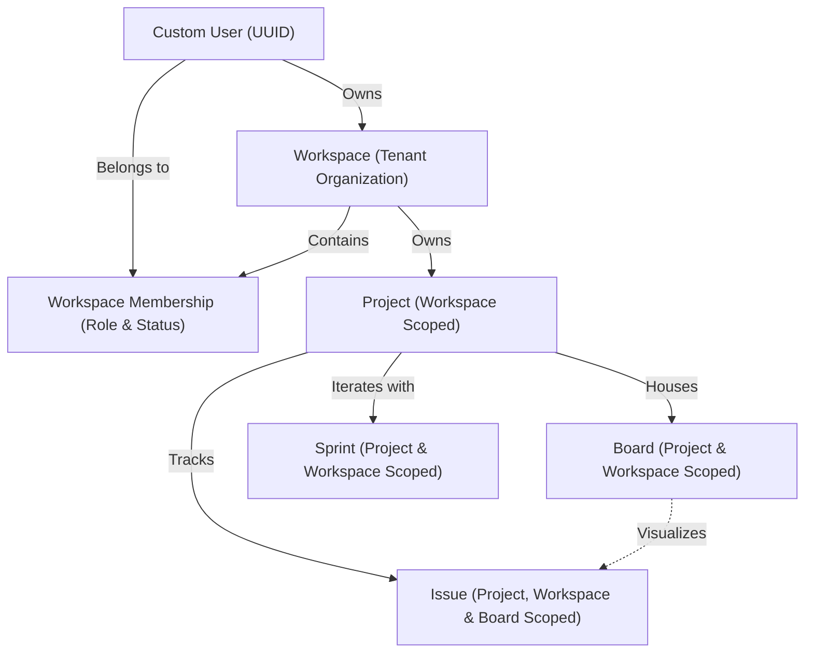

# Multi-Tenant Architecture

## 1. Overview & Strategy

**SprintSync** employs a **shared-schema multi-tenant architecture with row-level discriminator isolation** (PostgreSQL shared database, shared schema).

### Why Shared-Schema?
- **Operational Simplicity**: Single database and schema migration process; no dynamic connection routing or hundreds of PostgreSQL schemas to maintain.
- **Resource Efficiency**: Optimal memory and connection pool utilization across micro/standard instances.
- **Unified Analytics & Backup**: Standardized database snapshots and indexing pipelines.
- **Scalability**: Seamless horizontal scaling via read replicas, partitioned tables, and workspace-indexed query plans.

---

## 2. Tenant Scoping Principle

Every business entity in SprintSync (Projects, Boards, Issues, Sprints) belongs strictly to a **Workspace**:

1. **Foreign Key Binding**: Every tenant table carries a foreign key `workspace_id` referencing `apps_workspaces.Workspace`.
2. **Compound Indexing**: All tenant queries utilize compound indexes prefixed with `workspace_id` (e.g. `(workspace_id, slug)`, `(workspace_id, status)`).
3. **Workspace Isolation**: Data queries must always be filtered by the authenticated user's active workspace. Frontend filtering is never relied upon.

---

## 3. Core Domain Entities

### User (`apps.accounts.User`)
- Primary identifier: **UUIDv4**.
- Authentication credential: Normalized **email** (unique).
- Security: Passwords stored exclusively via PBKDF2 with SHA-256 password hashing. Plaintext passwords are never stored.

### Workspace (`apps.workspaces.Workspace`)
- Represents an independent tenant organization.
- Unique slug identifier for organization URL routing.
- Owned by a single user (`owner`), who can own multiple workspaces.

### Workspace Membership (`apps.workspaces.WorkspaceMembership`)
- Many-to-Many bridge between `User` and `Workspace`.
- Roles: `OWNER`, `ADMIN`, `PROJECT_MANAGER`, `MEMBER`, `VIEWER`.
- Statuses: `INVITED`, `ACTIVE`, `SUSPENDED`.
- Enforces single membership per user per workspace (`UniqueConstraint(fields=['workspace', 'user'])`).

### Project (`apps.projects.Project`)
- Represents a discrete initiative within a workspace.
- Slugs are unique within each workspace (allowing different organizations to share common slugs like `backend` or `website`).
- Owner must be an active workspace member.
- Start and due dates validated by database check constraints.

### Board (`apps.boards.Board`)
- Visual Kanban or Scrum board for workflow management.
- Scoped to both `project` and `workspace`.
- Uniqueness enforced on `(project, name)`.

### Issue (`apps.issues.Issue`)
- Work unit (Task, Bug, Story, Epic) with status (`TODO`, `IN_PROGRESS`, `IN_REVIEW`, `DONE`) and priority (`LOW`, `MEDIUM`, `HIGH`, `CRITICAL`).
- Scoped to `project`, `workspace`, and optionally `board`.
- Issue keys (e.g., `PROJ-101`) are unique within the workspace.
- Reporter and Assignee must be active workspace members.

### Sprint (`apps.sprints.Sprint`)
- Agile sprint cycle (`PLANNED`, `ACTIVE`, `COMPLETED`) scoped to `project` and `workspace`.
- Database constraint ensures `end_date >= start_date`.

