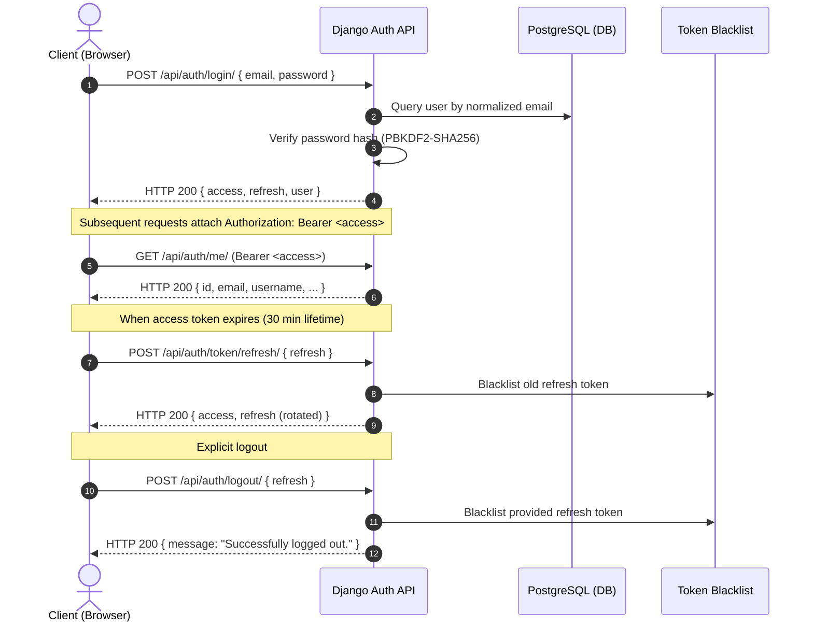

# Authentication & JWT Architecture

## 1. Overview

**SprintSync** employs a stateless, token-based authentication mechanism using **Django REST Framework SimpleJWT** paired with custom session invalidation through PostgreSQL-persisted token blacklists.

Authentication revolves around the **custom `User` model** (`apps.accounts.User`) with a normalized, case-insensitive email as the primary login credential.



---

## 2. Token Lifetimes & Rotation Policy

| Parameter | Configuration | Description |
|---|---|---|
| **Access Token Lifetime** | 30 minutes | Short-lived token for authorized API requests |
| **Refresh Token Lifetime** | 7 days | Long-lived token used to acquire fresh access tokens |
| **Token Rotation** | `ROTATE_REFRESH_TOKENS = True` | Issuing a new refresh token upon every refresh request |
| **Token Blacklisting** | `BLACKLIST_AFTER_ROTATION = True` | Invalidate used refresh tokens immediately |
| **Algorithm** | `HS256` | HMAC with SHA-256 using server secret |
| **Header Type** | `Bearer <token>` | Standard HTTP Authorization scheme |

---

## 3. API Endpoints

### A. Register (`POST /api/auth/register/`)
- **Request Body**:
  ```json
  {
    "email": "user@example.com",
    "username": "rohan",
    "first_name": "Rohan",
    "last_name": "Peerla",
    "password": "StrongPassword123!",
    "password_confirm": "StrongPassword123!"
  }
  ```
- **Validation Rules**:
  - Email normalized to lowercase and checked for uniqueness.
  - Username checked for uniqueness.
  - Password strength validated against Django password validators (length >= 8, similarity, numeric checks).
  - Passwords must match.
- **Response**: `HTTP 201 Created` with user details. Passwords are never returned.

### B. Login (`POST /api/auth/login/`)
- **Request Body**:
  ```json
  {
    "email": "user@example.com",
    "password": "StrongPassword123!"
  }
  ```
- **Response**: `HTTP 200 OK`
  ```json
  {
    "status": "success",
    "access": "<jwt_access_token>",
    "refresh": "<jwt_refresh_token>",
    "user": {
      "id": "uuid",
      "email": "user@example.com",
      "username": "rohan",
      "first_name": "Rohan",
      "last_name": "Peerla"
    }
  }
  ```
- **Security Protections**:
  - Rejects invalid credentials with a generic error message (`"Invalid email or password."`) to prevent user enumeration.
  - Rejects inactive accounts with a dedicated security message.

### C. Token Refresh (`POST /api/auth/token/refresh/`)
- **Request Body**: `{ "refresh": "<refresh_token>" }`
- **Response**: `{ "access": "<new_access_token>", "refresh": "<new_refresh_token>" }`
- Replaying a blacklisted or previously rotated refresh token returns `HTTP 401 Unauthorized`.

### D. Logout (`POST /api/auth/logout/`)
- **Headers**: `Authorization: Bearer <access_token>`
- **Request Body**: `{ "refresh": "<refresh_token>" }`
- Adds the token to `token_blacklist_outstandingtoken` and `token_blacklist_blacklistedtoken`.

### E. User Profile (`GET`, `PATCH /api/auth/me/`)
- **Headers**: `Authorization: Bearer <access_token>`
- `GET`: Returns the profile of the caller.
- `PATCH`: Allows updating `first_name`, `last_name`, and `username` (uniqueness checked). Modifying email, permissions, or passwords via this endpoint is prohibited.

### F. Change Password (`POST /api/auth/change-password/`)
- **Headers**: `Authorization: Bearer <access_token>`
- **Request Body**:
  ```json
  {
    "current_password": "OldPassword123!",
    "new_password": "NewPassword123!",
    "new_password_confirm": "NewPassword123!"
  }
  ```
- Verifies current password against stored PBKDF2 hash before updating.

---

## 4. Password Security Standards
- Passwords hashed using Django's default PBKDF2 with SHA-256 algorithm and salt.
- Plaintext passwords are never saved, cached, or logged.

