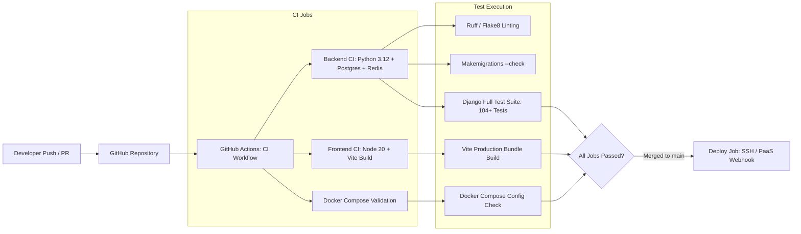

# Continuous Integration & Continuous Deployment (CI/CD)

SprintSync includes an automated GitHub Actions CI/CD pipeline ensuring code quality, security checks, unit testing, and automated deployments.

---

## CI/CD Pipeline Architecture



---

## 1. CI Workflow Specification (`.github/workflows/ci.yml`)

The CI workflow triggers automatically on:
- `push` to branches: `main`, `master`, `develop`.
- `pull_request` targeting `main`, `master`.

### Job 1: `backend-ci`
- **Runner**: `ubuntu-latest`.
- **Services**:
  - `postgres:16-alpine`: Provides live PostgreSQL service with health check on port `5432`.
  - `redis:7-alpine`: Provides Redis broker on port `6379`.
- **Steps**:
  1. Check out code (`actions/checkout@v4`).
  2. Set up Python 3.12 (`actions/setup-python@v5`) with pip cache.
  3. Install dependencies from `backend/requirements.txt`.
  4. Run code formatting and lint verification (`ruff`).
  5. Validate pending Django migrations: `python backend/manage.py makemigrations --check --dry-run`.
  6. Execute the full Django test suite:
     ```bash
     python backend/manage.py test apps.accounts apps.workspaces apps.projects apps.boards apps.issues apps.sprints apps.notifications apps.webhooks apps.billing apps.core
     ```

### Job 2: `frontend-ci`
- **Runner**: `ubuntu-latest`.
- **Steps**:
  1. Check out code (`actions/checkout@v4`).
  2. Set up Node.js 20 (`actions/setup-node@v4`) with npm cache.
  3. Install dependencies: `npm ci --prefix frontend`.
  4. Verify production bundle build: `npm run build --prefix frontend`.

### Job 3: `docker-validation`
- **Runner**: `ubuntu-latest`.
- **Steps**:
  1. Validate `docker-compose.yml` syntax using `docker compose config`.
  2. Lint and build `backend/Dockerfile` and `frontend/Dockerfile`.

---

## 2. CD Deployment Template (`.github/workflows/deploy.yml.example`)

A ready-to-use continuous deployment workflow template is provided in `.github/workflows/deploy.yml.example`.

### Deployment Steps:
1. Triggered on push or release to `main`.
2. Connects to the production server via SSH using `appleboy/ssh-action`.
3. Runs:
   ```bash
   cd /opt/sprintsync
   git pull origin main
   docker compose build backend frontend
   docker compose run --rm backend python manage.py migrate --noinput
   docker compose up -d --remove-orphans
   ```
4. Health check validation: curls `https://sprintsync.example.com/api/health/?detailed=true` and verifies HTTP 200 with `"status": "ok"`.

---

## 3. Required GitHub Secrets

To enable automated production deployments, configure the following secrets in **Settings > Secrets and variables > Actions**:

| Secret Key | Description |
|------------|-------------|
| `PROD_HOST` | Server IP or hostname |
| `PROD_USERNAME` | SSH user (e.g., `deploy` or `ubuntu`) |
| `PROD_SSH_KEY` | Private SSH key authorized on the target host |
| `PROD_PORT` | SSH port (default `22`) |
| `STRIPE_SECRET_KEY` | Stripe Production Secret Key |
| `STRIPE_WEBHOOK_SECRET` | Stripe Production Webhook Signing Secret |

