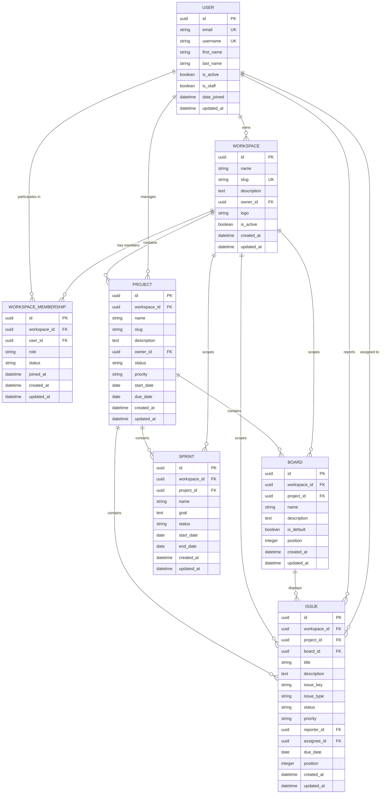

# Database Schema & Entity Relationships

## Entity-Relationship Diagram

---

## Model Specifications & Constraints

### 1. `accounts_user`
| Column | Type | Constraints / Attributes |
|---|---|---|
| `id` | UUID | Primary Key, `uuid.uuid4` |
| `email` | VARCHAR(255) | Unique, Indexed, Primary Login Identifier |
| `username` | VARCHAR(150) | Unique, Indexed |
| `first_name` | VARCHAR(150) | Blank allowed |
| `last_name` | VARCHAR(150) | Blank allowed |
| `is_active` | BOOLEAN | Default: `True`, Indexed |
| `is_staff` | BOOLEAN | Default: `False` |
| `date_joined` | TIMESTAMPTZ | Default: `timezone.now` |
| `updated_at` | TIMESTAMPTZ | Auto now |

### 2. `workspaces_workspace`
| Column | Type | Constraints / Attributes |
|---|---|---|
| `id` | UUID | Primary Key, `uuid.uuid4` |
| `name` | VARCHAR(255) | Organization display name |
| `slug` | VARCHAR(255) | Unique, Indexed |
| `description` | TEXT | Blank allowed |
| `owner_id` | UUID | Foreign Key -> `accounts_user(id)`, `on_delete=PROTECT` |
| `logo` | VARCHAR(500) | Blank allowed |
| `is_active` | BOOLEAN | Default: `True`, Indexed |
| `created_at` | TIMESTAMPTZ | Auto now add, Indexed |
| `updated_at` | TIMESTAMPTZ | Auto now |

### 3. `workspaces_workspacemembership`
| Column | Type | Constraints / Attributes |
|---|---|---|
| `id` | UUID | Primary Key, `uuid.uuid4` |
| `workspace_id` | UUID | Foreign Key -> `workspaces_workspace(id)`, `on_delete=CASCADE` |
| `user_id` | UUID | Foreign Key -> `accounts_user(id)`, `on_delete=CASCADE` |
| `role` | VARCHAR(30) | `OWNER`, `ADMIN`, `PROJECT_MANAGER`, `MEMBER`, `VIEWER` |
| `status` | VARCHAR(30) | `INVITED`, `ACTIVE`, `SUSPENDED` |
| `joined_at` | TIMESTAMPTZ | Nullable |
| `created_at` | TIMESTAMPTZ | Auto now add |
| `updated_at` | TIMESTAMPTZ | Auto now |

**Unique Constraint**: `unique_workspace_user_membership` on `(workspace_id, user_id)`.

### 4. `projects_project`
| Column | Type | Constraints / Attributes |
|---|---|---|
| `id` | UUID | Primary Key, `uuid.uuid4` |
| `workspace_id` | UUID | Foreign Key -> `workspaces_workspace(id)`, `on_delete=CASCADE` |
| `name` | VARCHAR(255) | Project name |
| `slug` | VARCHAR(255) | Project slug |
| `description` | TEXT | Blank allowed |
| `owner_id` | UUID | Foreign Key -> `accounts_user(id)`, `on_delete=PROTECT` |
| `status` | VARCHAR(30) | `PLANNING`, `ACTIVE`, `ON_HOLD`, `COMPLETED`, `ARCHIVED` |
| `priority` | VARCHAR(30) | `LOW`, `MEDIUM`, `HIGH`, `CRITICAL` |
| `start_date` | DATE | Nullable |
| `due_date` | DATE | Nullable |
| `created_at` | TIMESTAMPTZ | Auto now add, Indexed |
| `updated_at` | TIMESTAMPTZ | Auto now |

**Unique Constraint**: `unique_project_slug_per_workspace` on `(workspace_id, slug)`.  
**Check Constraint**: `due_date >= start_date` (or either is null).

### 5. `boards_board`
| Column | Type | Constraints / Attributes |
|---|---|---|
| `id` | UUID | Primary Key, `uuid.uuid4` |
| `workspace_id` | UUID | Foreign Key -> `workspaces_workspace(id)`, `on_delete=CASCADE` |
| `project_id` | UUID | Foreign Key -> `projects_project(id)`, `on_delete=CASCADE` |
| `name` | VARCHAR(255) | Board title |
| `description` | TEXT | Blank allowed |
| `is_default` | BOOLEAN | Default: `False` |
| `position` | INTEGER | Default: `0` |
| `created_at` | TIMESTAMPTZ | Auto now add |
| `updated_at` | TIMESTAMPTZ | Auto now |

**Unique Constraint**: `unique_board_name_per_project` on `(project_id, name)`.

### 6. `issues_issue`
| Column | Type | Constraints / Attributes |
|---|---|---|
| `id` | UUID | Primary Key, `uuid.uuid4` |
| `workspace_id` | UUID | Foreign Key -> `workspaces_workspace(id)`, `on_delete=CASCADE` |
| `project_id` | UUID | Foreign Key -> `projects_project(id)`, `on_delete=CASCADE` |
| `board_id` | UUID | Nullable Foreign Key -> `boards_board(id)`, `on_delete=SET_NULL` |
| `title` | VARCHAR(255) | Issue title |
| `description` | TEXT | Blank allowed |
| `issue_key` | VARCHAR(50) | e.g. `PROJ-101`, Indexed |
| `issue_type` | VARCHAR(30) | `TASK`, `BUG`, `STORY`, `EPIC` |
| `status` | VARCHAR(30) | `TODO`, `IN_PROGRESS`, `IN_REVIEW`, `DONE` |
| `priority` | VARCHAR(30) | `LOW`, `MEDIUM`, `HIGH`, `CRITICAL` |
| `reporter_id` | UUID | Foreign Key -> `accounts_user(id)`, `on_delete=PROTECT` |
| `assignee_id` | UUID | Nullable Foreign Key -> `accounts_user(id)`, `on_delete=SET_NULL` |
| `due_date` | DATE | Nullable |
| `position` | INTEGER | Default: `0` |
| `created_at` | TIMESTAMPTZ | Auto now add, Indexed |
| `updated_at` | TIMESTAMPTZ | Auto now |

**Unique Constraint**: `unique_issue_key_per_workspace` on `(workspace_id, issue_key)`.

### 7. `sprints_sprint`
| Column | Type | Constraints / Attributes |
|---|---|---|
| `id` | UUID | Primary Key, `uuid.uuid4` |
| `workspace_id` | UUID | Foreign Key -> `workspaces_workspace(id)`, `on_delete=CASCADE` |
| `project_id` | UUID | Foreign Key -> `projects_project(id)`, `on_delete=CASCADE` |
| `name` | VARCHAR(255) | Sprint name |
| `goal` | TEXT | Blank allowed |
| `status` | VARCHAR(30) | `PLANNED`, `ACTIVE`, `COMPLETED` |
| `start_date` | DATE | Nullable |
| `end_date` | DATE | Nullable |
| `created_at` | TIMESTAMPTZ | Auto now add |
| `updated_at` | TIMESTAMPTZ | Auto now |

**Check Constraint**: `end_date >= start_date` (or either is null).

