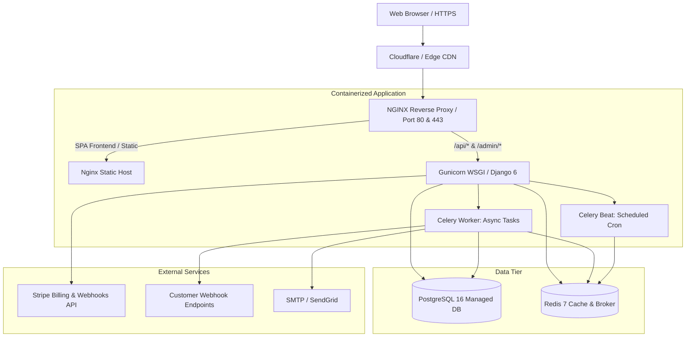

# Production Deployment Guide

This guide covers deploying **SprintSync** to production using containerized deployment architectures or cloud hosting platforms.

---

## Architecture Overview



---

## 1. Hosting Provider Strategies

### Option A: Cloud VPS with Docker Compose (Hetzner, DigitalOcean Droplet, AWS EC2)
- **Minimum Requirements**: 2 vCPUs, 4GB RAM, 40GB SSD.
- **Recommended Setup**:
  1. Install Ubuntu 22.04 LTS / 24.04 LTS.
  2. Install Docker CE and Docker Compose plugin (`docker compose version`).
  3. Clone the repository and configure `.env` with production secrets (`DEBUG=False`, strong `SECRET_KEY`, PostgreSQL credentials, Stripe Live/Test keys).
  4. Place Certbot / Let's Encrypt or Nginx Proxy Manager in front of the application for SSL termination.
  5. Run:
     ```bash
     docker compose up -d --build
     ```

### Option B: Managed PaaS (Render, Railway, Fly.io)
- **Database**: Provision managed PostgreSQL 16 (Render PostgreSQL, AWS RDS, Supabase).
- **Cache/Broker**: Provision managed Redis (Upstash, Redis Cloud, Render Redis).
- **Backend Service**:
  - Deploy from Dockerfile (`backend/Dockerfile`).
  - Set environment variables (`DATABASE_URL`, `REDIS_URL`, `SECRET_KEY`, `DEBUG=False`, `ALLOWED_HOSTS`, `CSRF_TRUSTED_ORIGINS`).
  - Health check path: `/api/health/?detailed=true`.
- **Worker Service**:
  - Deploy identical image with entrypoint override: `celery -A config worker -l info --concurrency=2`.
- **Beat Service**:
  - Deploy identical image with entrypoint override: `celery -A config beat -l info`.
- **Frontend Service**:
  - Deploy from Dockerfile (`frontend/Dockerfile`) or deploy as Static Site from `frontend/` using `npm run build` and output directory `frontend/dist`.

---

## 2. Production Security Configuration

When running with `DEBUG=False`, Django automatically activates production security headers:

| Setting | Default in Settings | Recommended Production Value |
|---------|---------------------|-------------------------------|
| `DEBUG` | `False` | `False` |
| `SECRET_KEY` | *(Must be set via env)* | 50+ random characters |
| `ALLOWED_HOSTS` | `*` | `app.sprintsync.com,api.sprintsync.com` |
| `CSRF_TRUSTED_ORIGINS` | *(Empty)* | `https://app.sprintsync.com,https://api.sprintsync.com` |
| `SECURE_SSL_REDIRECT` | `False` | `True` (if not terminated at load balancer) |
| `SESSION_COOKIE_SECURE` | `False` | `True` |
| `CSRF_COOKIE_SECURE` | `False` | `True` |
| `SECURE_HSTS_SECONDS` | `0` | `31536000` (1 year) |

Verify the deployment settings using Django's check:
```bash
python manage.py check --deploy
```

---

## 3. Media & Persistent Storage

- In local Docker, user avatars and issue file attachments are persisted in the `media_data` named Docker volume mounted at `/app/media`.
- For multi-instance horizontal scaling, attach an S3-compatible object store (AWS S3, Cloudflare R2, DigitalOcean Spaces) using `django-storages`.

---

## 4. Zero-Downtime Deployments

To update the application without downtime on a single VPS:
```bash
# 1. Pull latest git code
git pull origin main

# 2. Rebuild images
docker compose build backend frontend

# 3. Apply database migrations
docker compose run --rm backend python manage.py migrate --noinput

# 4. Restart containers with minimal delay
docker compose up -d --no-deps backend celery_worker celery_beat frontend
```

