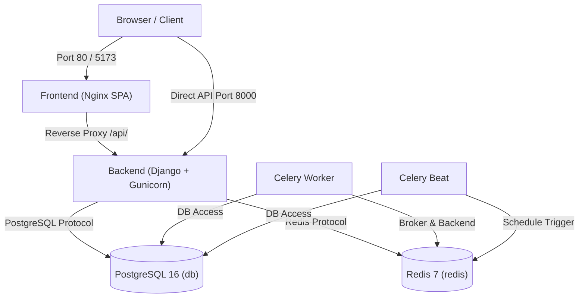

# SprintSync Local & Containerized Docker Setup

## 1. Prerequisites
- Docker Engine 24.0+ and Docker Compose v2.20+ (or Docker Desktop on Windows/macOS).
- Alternatively, Python 3.12, Node.js 20, PostgreSQL 16, and Redis if running bare-metal.

---

## 2. Docker Architecture

SprintSync's containerized infrastructure runs via `docker-compose.yml` with 6 orchestrated services:



---

## 3. Quick Start with Docker Compose

### Step 1: Clone Repository & Create Environment Configuration
```powershell
# In PowerShell or Terminal
Copy-Item .env.example .env
```
Ensure `.env` contains your desired passwords and Stripe test mode keys.

### Step 2: Build & Start Services
```powershell
# Build and start all 6 containers in detached mode
docker compose up -d --build
```

### Step 3: Verify Container Health
```powershell
# Inspect container status and health checks
docker compose ps
```

Expected status:
| Container Name | Service | Status | Port Mapping |
|---|---|---|---|
| `sprintsync_db` | PostgreSQL 16 | Up (healthy) | Internal 5432 |
| `sprintsync_redis` | Redis 7 | Up (healthy) | Internal 6379 |
| `sprintsync_backend` | Django Gunicorn | Up (healthy) | `0.0.0.0:8000->8000` |
| `sprintsync_celery_worker` | Celery Worker | Up | Internal |
| `sprintsync_celery_beat` | Celery Beat | Up | Internal |
| `sprintsync_frontend` | Nginx Client | Up (healthy) | `0.0.0.0:80->80`, `0.0.0.0:5173->80` |

### Step 4: Open Application in Browser
- Frontend Web Client: [http://localhost](http://localhost) (or [http://localhost:5173](http://localhost:5173))
- Backend API Root: [http://localhost:8000/api/](http://localhost:8000/api/)
- Health Check: [http://localhost:8000/api/health/?detailed=true](http://localhost:8000/api/health/?detailed=true)

---

## 4. Useful Docker Commands

### Viewing Logs
```powershell
# View logs from all services in real time
docker compose logs -f

# View logs for a specific service
docker compose logs -f backend
docker compose logs -f celery_worker
docker compose logs -f frontend
```

### Running Django Management Commands in Docker
```powershell
# Create superuser
docker compose exec backend python manage.py createsuperuser

# Re-seed subscription plans
docker compose exec backend python manage.py seed_plans

# Open interactive Django shell
docker compose exec backend python manage.py shell
```

### Stopping & Restarting Containers
```powershell
# Stop all containers preserving persistent data volumes
docker compose down

# Stop and restart containers
docker compose restart backend celery_worker
```

