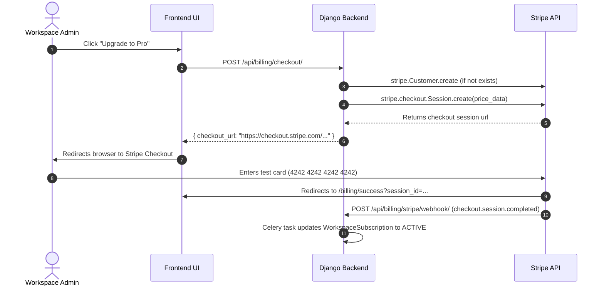

# Stripe Integration Guide (Test Mode)

## 1. Safety and PCI Compliance Rules
1. **Strictly Test Mode**: SprintSync connects exclusively with Stripe Test Mode API keys prefixed with `sk_test_` and publishable keys `pk_test_`. Any key attempting to use live credentials is automatically rejected.
2. **Zero Cardholder Data Storage**: No credit card numbers, CVVs, expiration dates, or bank details are ever handled by or stored on SprintSync servers. All checkout and payment methods are collected securely via Stripe-hosted Checkout sessions and Stripe Customer Portal.
3. **Mocking in Automated Tests**: All unit and integration tests strictly mock Stripe SDK requests (`stripe.checkout.Session.create`, `stripe.billing_portal.Session.create`, `stripe.Customer.create`).

---

## 2. Configuration & Environment Variables

Add the following to `backend/.env`:
```ini
# Stripe Test Configuration
STRIPE_SECRET_KEY=sk_test_placeholder_key_for_testing
STRIPE_PUBLISHABLE_KEY=pk_test_placeholder_key_for_testing
STRIPE_WEBHOOK_SECRET=whsec_placeholder_for_local_dev
STRIPE_SUCCESS_URL=http://localhost:5173/billing/success?session_id={CHECKOUT_SESSION_ID}
STRIPE_CANCEL_URL=http://localhost:5173/workspaces/{workspace_id}/settings/billing
```

---

## 3. Stripe Checkout Flow



---

## 4. Stripe Customer Portal Flow

Admins can manage subscriptions directly inside the hosted Stripe Customer Portal:
1. Admin clicks **"Stripe Customer Portal"** in workspace settings.
2. Frontend calls `POST /api/billing/customer-portal/` with `{ workspace_id, return_url }`.
3. Backend calls `stripe.billing_portal.Session.create(customer=stripe_customer_id, return_url=return_url)`.
4. Browser redirects to Stripe Customer Portal where the user can update their card, view billing history, or manage their subscription.

---

## 5. Webhook Ingestion & Celery Idempotency

All webhooks received at `POST /api/billing/stripe/webhook/` undergo cryptographic validation:
1. `stripe.Webhook.construct_event(payload, sig_header, secret)` verifies signature.
2. Event record is created in `StripeWebhookEvent(stripe_event_id=..., event_type=...)`.
3. Duplicate events are identified via `processed=True` and ignored.
4. Celery background task `process_stripe_webhook_event_task.delay()` executes the state transitions asynchronously:
   - `checkout.session.completed`: Upgrades workspace to paid tier.
   - `customer.subscription.updated`: Synchronizes renewal date and subscription status.
   - `customer.subscription.deleted`: Reverts workspace subscription to `CANCELED` (Free tier limits apply).
   - `invoice.payment_succeeded`: Saves `BillingInvoice` and dispatches in-app receipt notification.
   - `invoice.payment_failed`: Marks status as `PAST_DUE` and dispatches warning notification to workspace owner.

---

## 6. Local Webhook Testing with Stripe CLI

To stream test events from Stripe to local development:
```bash
stripe login
stripe listen --forward-to localhost:8000/api/billing/stripe/webhook/
```
Copy the webhook signing secret output by the CLI (e.g. `whsec_...`) into `backend/.env` as `STRIPE_WEBHOOK_SECRET`.
To trigger test events:
```bash
stripe trigger checkout.session.completed
stripe trigger invoice.payment_succeeded
```

