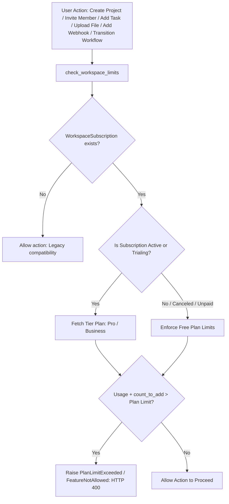

# Server-Side Plan Limit Enforcement

## 1. Architecture

Plan limits are strictly enforced server-side via the centralized service function:
`check_workspace_limits(workspace, limit_type, count_to_add=1)` located in `apps/billing/usage_service.py`.



---

## 2. Enforced Limits & Intercepted Endpoints

| Resource | Action Key | Intercepted Endpoint | Limit Check Rule |
|---|---|---|---|
| **Members** | `add_member` | `POST /api/workspaces/{id}/members/` | Active members count + 1 <= `plan.max_members` |
| **Projects** | `create_project` | `POST /api/workspaces/{id}/projects/` | Projects count + 1 <= `plan.max_projects` |
| **Tasks** | `create_task` | `POST /api/projects/{id}/issues/` | Total issues count + 1 <= `plan.max_tasks` |
| **Storage** | `upload_attachment` | `POST /api/issues/{id}/attachments/` | Total attachments size + `file.size` <= `plan.max_storage_bytes` |
| **Webhooks** | `create_webhook` | `POST /api/workspaces/{id}/webhooks/` | Active webhooks + 1 <= `plan.max_webhooks` AND `features.webhooks == True` |
| **Workflows** | `custom_workflow` | `POST /api/boards/{id}/transitions/` | `features.custom_workflows == True` |

---

## 3. Standard Error Response Payloads

When a user attempts to perform an operation that exceeds their plan limits, a standardized HTTP 400 Bad Request error payload is returned with actionable upgrade information:

### Limit Exceeded:
```json
{
  "error": "Workspace member limit reached (5/5). Please upgrade your subscription to invite more team members.",
  "limit_type": "max_members",
  "current_usage": 5,
  "allowed_limit": 5,
  "upgrade_required": true
}
```

### Feature Flag Not Allowed:
```json
{
  "error": "Webhook integrations are not included on the Free plan. Please upgrade to Pro or Business.",
  "feature_name": "webhooks",
  "upgrade_required": true
}
```

---

## 4. Graceful Downgrades Policy

When a workspace subscription is canceled or expired:
1. **Zero Data Deletion**: Existing projects, tasks, attachments, members, and webhooks are **never deleted**.
2. **Read-Only Excess**: Users retain full read and edit access to all pre-existing records.
3. **Creation Gate**: Any attempts to create *new* projects, tasks, members, attachments, or webhooks beyond the Free plan limits are rejected until an upgrade is completed or excess items are removed.

